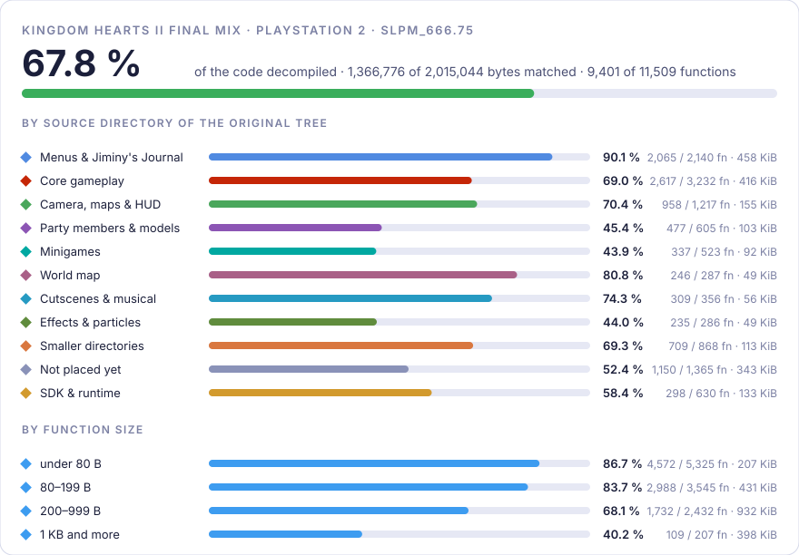

# Kingdom Hearts II Final Mix decompilation

A work-in-progress, byte-matching decompilation of *Kingdom Hearts II Final
Mix* for the PlayStation 2 (Japan, `SLPM_666.75`): C++ source that Sony's
`ee-gcc 3.2-040921` compiles back into the exact bytes of the game's main
executable.

**Progress site: <https://sh1ftmaker.github.io/kh2/>**

<!-- assets:start -->
<p align="center">
  <a href="https://sh1ftmaker.github.io/kh2/"></a>
  <a href="https://sh1ftmaker.github.io/kh2/"></a>
  <a href="https://sh1ftmaker.github.io/kh2/"></a>
  <a href="https://sh1ftmaker.github.io/kh2/"></a>
  <a href="https://github.com/sh1ftmaker/kh2/actions/workflows/pages.yml"></a>
</p>

<a href="https://sh1ftmaker.github.io/kh2/">
<picture>
  <source media="(prefers-color-scheme: dark)" srcset="site/badges/progress-dark.svg">
  <source media="(prefers-color-scheme: light)" srcset="site/badges/progress-light.svg">
  
</picture>
</a>
<!-- assets:end -->

<!-- status:start -->
Status (2026-11-26, written by `tools/site_data.py`): 6,247 of 14,618 functions, 402,992 of 2,226,245 bytes of code matched (18.1 %); structural progress 20.1 % (448,513 bytes, matched code plus partial credit for 351 structurally matched functions); 10,552 functions are written (72.9 % of the code), 54.5 % counting each by how closely it matches. By function size: under 80 B 64.5 %, 80–199 B 39.2 %, 200–999 B 4.30 %, 1 KB and more 0.32 %. Game code 6,097 / 13,806 functions (19.1 % of its bytes; Menus & Jiminy's Journal 18.7 %, Core gameplay 24.3 %, Camera, maps & HUD 28.7 %, Party members & models 14.6 %, Minigames 13.6 %, World map 22.1 %, Cutscenes & musical 27.6 %, Effects & particles 16.9 %, Smaller directories 20.0 %, Not placed yet 10.5 %); SDK & runtime 150 / 812 functions (3.40 %). 32 of 574 files in the file map have every function matched. The five overlays are not started. `make` ends in MATCHED!.
<!-- status:end -->

This repository contains no game data. You need your own copy of the game to
build it.

## What the numbers mean

- **Matched** is the headline: the function's source is linked into the
  executable and the whole executable is byte-identical to the original. It
  is counted in bytes of code; the function count is shown beside it because
  thousands of tiny functions inflate it.
- **Reviewed** is the part of the matched code with evidenced names, real
  types and a place in its original source file. Code in `src/anon` and
  `src/autodecomp` is matched but machine-written and not yet reviewed.
- **Structural progress** adds partial credit (size times match percentage)
  for functions that are written and differ from the original only in the
  compiler's register choice or instruction order. These live in
  `nonmatching/`, are never linked, and are not counted as matched.
- **Written** counts every function that has compiling source at all,
  matched or not. Most unmatched ones are machine-written first drafts.

## Building

```sh
isoinfo -i "<your iso>" -x '/SLPM_666.75;1' > SLPM_666.75
# sha256 d869ce4b8edd61cb978c4ff9ede595fe4d7d7b21cbb96a145275217120d8bc87

tools/setup_toolchain.sh <path>/ee-gcc3.2-040921-full.tar.gz ~/ps2
source ~/ps2/env.sh
python3 tools/build_elf.py objects && make     # ends in MATCHED!
python3 tools/progress_bytes.py
```

Needs x86_64 Linux with 32-bit glibc, `patchelf`, `python3` and `make`. The
compiler archive is not distributed here.
[docs/native-toolchain.md](docs/native-toolchain.md) has the details and the
Docker alternative.

## How the project works

Modelled on the [Four Swords Adventures decompilation](https://github.com/sh1ftmaker/fsa):

- One rule book for people and AI agents alike: [CLAUDE.md](CLAUDE.md),
  [AGENTS.md](AGENTS.md), [docs/RULES_CARD.md](docs/RULES_CARD.md).
- No fakematches: no inline asm, register pins or code shaped only to steer
  the compiler. Names need evidence; unproven names keep their address.
- A reviewer that never saw the author's reasoning judges every hand-written
  submission ([docs/REVIEW_BRIEF.md](docs/REVIEW_BRIEF.md)).
- Structure first, byte match second.
- The plan is [docs/PLAN.md](docs/PLAN.md); the site's roadmap is
  [docs/roadmap.yml](docs/roadmap.yml).

Tools worth knowing: `tools/rig/compile_diff.py` scores one function against
the original in about 80 ms; `tools/rig/get_context.py` gathers everything
known about a function; `tools/rig/promote.py` lands a match and rolls back
if the executable stops matching. [docs/rig/README.md](docs/rig/README.md)
describes them, and [docs/codegen-3.2.md](docs/codegen-3.2.md) records what
this compiler does.

## Symbols and file layout

Names, class layouts and the original file layout come from the debug
information in the E3 2014 PS3 kiosk demo of the HD remaster: 25,356
functions and 5,859 types, of which about 7,600 functions are mapped to
their PS2 counterparts with a graded confidence (`data/e3`). The HD build
changed many class layouts, so its headers are a starting point that is
checked against the PS2 code, not copied.

The five code overlays in `OVL.IMG` (gumi ship battle and menu, shop, title,
movie) are not built yet.

## Contributing

See [CONTRIBUTING.md](CONTRIBUTING.md). AI-assisted work is welcome under the
same rules as any other.

## Credits and license

This project continues [GovanifY's kh2](https://github.com/GovanifY/kh2)
("dasein"), which built the matching build system, the first 4,680 matched
functions and the header skeletons. MIT license, see [LICENSE](LICENSE).

Kingdom Hearts is a trademark of its owners. This project is not affiliated
with or endorsed by them, and is non-commercial.
